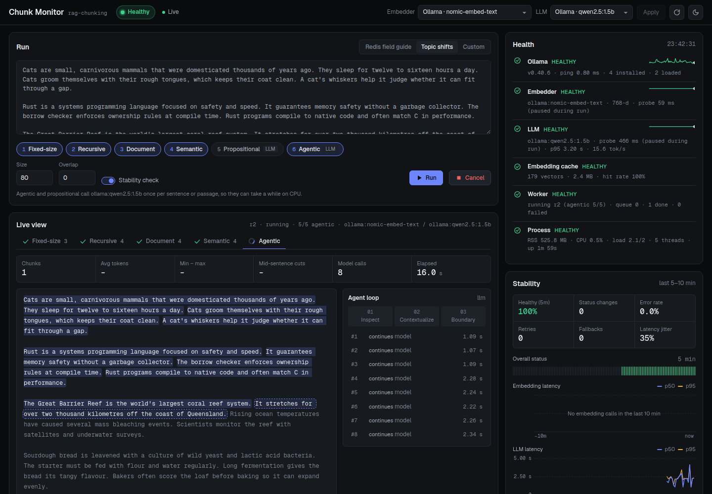

# rag-chunking

[](https://github.com/patlar104/rag-chunking/actions/workflows/ci.yml)
[](https://github.com/patlar104/rag-chunking/actions/workflows/codeql.yml)
[](#choosing-a-python-version)
[](#choosing-a-python-version)
[](LICENSE)
[](https://rag-chunking.pplx.app)

A working implementation of **"The 6 Production Chunking Algorithms for RAG (Part 2/7)"** by [@aiunpacked.explains](https://www.instagram.com/reel/DcD9jzKFH7z/).

The reel's thesis: *chunking is where 80% of RAG pipelines fail.* Chunks that are too small lose context; chunks that are too large dilute the embedding. This repo builds every idea from the video so you can run it, compare the results and plug it into your own pipeline.

Pure Python 3.13+ (3.15 recommended), **zero required dependencies**. Everything runs offline out of the box. Real embedding models (Ollama, sentence-transformers, DeepInfra, OpenAI) and local LLMs through Ollama plug in with one flag. There are LangChain and LlamaIndex integrations, plus a live web dashboard for health and stability.

**Live demo:** [rag-chunking.pplx.app](https://rag-chunking.pplx.app) runs the Chunk Monitor dashboard in offline mode (hashing embedder + rule-based heuristics). Run it locally with Ollama or DeepInfra for real models.

## What's in the reel → where it lives

| Reel slide | What it means | Code |
|---|---|---|
| Problem #1: too small = lost context | boundaries cut through sentences/ideas | `chunk_stats()` → `mid_sentence_cuts` |
| Problem #2: too large = embedding noise | one chunk holds several topics | `chunk_stats()` → `max_tokens`, `oversized_chunks` |
| The practical fix: sliding window + 20–50 token overlap | neighbours share a few tokens | `FixedSizeChunker(overlap=…)`, `with_overlap()` for any chunker |
| 01 Fixed-size: fast character or token slicing | | `chunking/fixed.py` |
| 02 Recursive: paragraphs → sentences → words | | `chunking/recursive.py` |
| 03 Document-based: preserve Markdown, tables and code | | `chunking/document.py` |
| 04 Semantic: cut when embedding distance spikes | | `chunking/semantic.py` |
| 05 Propositional: decompose text into atomic facts | | `chunking/propositional.py` |
| 06 Agentic: a small model inspects context and places the boundary (inspect → contextualize → boundary) | | `chunking/agentic.py` |
| The rule: pick the strategy that fits your data structure | | `python demo.py --compare` |

## Setup

You need **Python 3.13 or newer** (3.15 recommended) and git. Check with `python3 --version`.

### Choosing a Python version

| Version | Status here | Upstream support | Notes |
|---|---|---|---|
| **3.15** | **recommended**, tested in CI | bugfix releases until 2031-10 | newest stable release (3.15.0, Oct 9 2026) |
| 3.14 | supported, tested in CI | bugfix releases until 2030-10 | safest choice if a third-party extra hasn't shipped 3.15 wheels yet |
| 3.13 | minimum, tested in CI | security fixes only, until 2029-10 | |
| 3.12 and older | not supported | | `import chunking` stops with a clear error; pip refuses to install |

Newer versions after 3.15 should work too (there's no upper bound). The weekly CI run tests the newest releases. Upstream dates come from the [Python devguide](https://devguide.python.org/versions/).

**Ways to get Python 3.15:**

| Tool | Command |
|---|---|
| [uv](https://docs.astral.sh/uv/) (any OS, fastest) | `uv python install 3.15`, then `uv venv -p 3.15` |
| [python.org installer](https://www.python.org/downloads/) | download 3.15, then use `python3.15` (macOS/Linux) or `py -3.15` (Windows) |
| pyenv | `pyenv install 3.15 && pyenv local 3.15` |
| Homebrew (macOS) | `brew install python@3.15` |
| winget (Windows) | `winget install Python.Python.3.15` |

The repo has a `.python-version` file set to `3.15`, so `uv`, `pyenv` and most editors pick it up automatically.

### 1. Clone and create a virtual environment

```bash
git clone https://github.com/patlar104/rag-chunking.git
cd rag-chunking
python3.15 -m venv .venv           # or: uv venv -p 3.15   ·   Windows: py -3.15 -m venv .venv
source .venv/bin/activate          # Windows: .venv\Scripts\activate
python -m pip install --upgrade pip
```

### 2. Install what you need

The core library has **no dependencies**: `python demo.py` works right after cloning. Install extras only for the features you want:

| Command | Adds |
|---|---|
| `pip install -e .` | the `chunking` package importable from anywhere (still zero dependencies) |
| `pip install -e ".[webui]"` | the Chunk Monitor dashboard (FastAPI + uvicorn) |
| `pip install -e ".[langchain]"` | `ChunkingTextSplitter` and `ChunkingEmbeddings` for LangChain |
| `pip install -e ".[llamaindex]"` | `ChunkingNodeParser` and `ChunkingEmbedding` for LlamaIndex |
| `pip install -e ".[st]"` | local sentence-transformers embeddings (pulls in PyTorch, ~1 GB) |
| `pip install -e ".[openai]"` | OpenAI or any OpenAI-compatible server |
| `pip install -e ".[dev]"` | everything the test suite and linter use |
| `pip install -e ".[all]"` | all of the above except dev tools |

Ollama and DeepInfra need no Python packages; their clients use the standard library.

### 3. Pick a model backend (optional)

Everything runs offline with a toy hashing embedder and rule-based heuristics. For real results, choose one:

- **Ollama (local, free):** install from [ollama.com/download](https://ollama.com/download), then
  ```bash
  ollama pull nomic-embed-text        # embeddings, 274 MB
  ollama pull llama3.2:3b             # LLM for agentic/propositional, 2 GB (qwen2.5:1.5b if you're short on RAM)
  python demo.py --doctor             # confirms what's detected
  ```
- **DeepInfra (hosted, no GPU):** create a key at [deepinfra.com/dash/api_keys](https://deepinfra.com/dash/api_keys), then `export DEEPINFRA_API_KEY=...` (PowerShell: `$env:DEEPINFRA_API_KEY="..."`).
- **OpenAI:** `pip install -e ".[openai]"` and `export OPENAI_API_KEY=...`.

### 4. Run it

```bash
python demo.py --compare                                                   # offline
python demo.py --embed ollama:nomic-embed-text --llm ollama:llama3.2:3b     # Ollama
python demo.py --embed deepinfra --llm deepinfra                            # DeepInfra
python -m webui.server --embed ollama:nomic-embed-text --llm ollama:llama3.2:3b   # dashboard on http://localhost:8000
```

### 5. Run the tests

```bash
python -m unittest discover -s tests          # 75 tests; integration tests skip if their extras aren't installed
pip install -e ".[dev]" && python -m unittest discover -s tests -v   # the full suite, like CI
ruff check .                                  # lint
CHUNKING_LIVE_OLLAMA=1 python -m unittest tests.test_backends       # also hit a real Ollama server
CHUNKING_LIVE_DEEPINFRA=1 python -m unittest tests.test_deepinfra   # also hit the real DeepInfra API
```

### Troubleshooting

| Symptom | Fix |
|---|---|
| `Can't reach Ollama at http://localhost:11434` | start it with `ollama serve` (or open the Ollama app), or set `OLLAMA_HOST` |
| `model 'x' not found, try pulling it` | `ollama pull x`, or add `--pull` to `demo.py` |
| `DeepInfra HTTP 401` | `DEEPINFRA_API_KEY` is missing or wrong |
| `ModuleNotFoundError: fastapi` | `pip install -e ".[webui]"` |
| `rag-chunking needs Python 3.13 or newer` | create the venv with a newer interpreter (see [Choosing a Python version](#choosing-a-python-version)) |
| An extra fails to build on the newest Python | a dependency hasn't published wheels for it yet; use 3.14 for that venv |
| Agentic chunking never splits prose | the LLM is too small; use a 3B+ model (`llama3.2:3b`, or `deepinfra`'s Qwen2.5-7B) |
| Slow second runs | they shouldn't be: embeddings are cached in `~/.cache/rag-chunking/` (move it with `CHUNKING_CACHE_DIR`) |

## Quick start

```bash
python demo.py                      # run all 6 strategies on sample.md
python demo.py --compare            # just the comparison table
python demo.py -s fixed --size 40 --overlap 10     # sliding window
python demo.py -q "What is the spending cap per team for the offsite?"   # best chunk per strategy
python demo.py my_notes.md -s document              # your own file
python demo.py --doctor                             # which real models are available
python demo.py --embed auto --llm auto              # use real local models if installed
python -m unittest discover -s tests                # 75 tests, no network needed
```

Sample output of `--compare` on `sample.md`:

```
strategy     chunks  avg_tokens  min  max  tiny_chunks  mid_sentence_cuts
fixed             5        78     70   80            0                  6
recursive         7      55.7     32   80            0                  0
document          8      52.5     34   69            0                  0
semantic          5        78     21  119            0                  0
propositional    22      12.8      8   22           17                  0
agentic           8      48.8     21   93            0                  0
```

Fixed-size is the only one that cuts through sentences, which is Problem #1 in action.

## Use it in code

```python
from chunking import get_chunker, with_overlap, chunk_stats

text = open("docs.md").read()

chunks = get_chunker("recursive", chunk_size=200).split(text)
chunks = with_overlap(text, chunks, overlap_tokens=30)   # the "practical fix"

for c in chunks:
    print(c.start, c.end, c.tokens, c.metadata)           # offsets point back into `text`

print(chunk_stats(text, chunks))
```

Each chunker has a `.split(text) -> list[Chunk]` method. A `Chunk` has `text`, `start`/`end` character offsets into the source, `.tokens`, and a `metadata` dict (heading path, cut reason, title, …) you can store in your vector DB next to the embedding.

## The strategies

**Fixed-size**: `FixedSizeChunker(chunk_size=200, overlap=30, unit="tokens"|"chars")`. It's the fastest and most predictable option, but it ignores meaning. Use it as a baseline, or for uniform text such as logs and transcripts.

**Recursive**: `RecursiveChunker(chunk_size=200, separators=[...])`. It tries `\n\n` first, then `\n`, then sentence ends, clauses, words and characters, and merges small neighbours back up to the limit. This is a good default for prose. Headings can end up at the bottom of the previous chunk, which document-based chunking fixes.

**Document-based**: `MarkdownChunker(max_tokens=300)`. It splits on headings and keeps tables and fenced code blocks **atomic**, even when they're over the limit. It also prefixes each chunk with its heading path (`Redis Field Guide > Installation`) so the chunk makes sense on its own. Best for docs, wikis, READMEs and notes.

**Semantic**: `SemanticChunker(embed=..., breakpoint_percentile=80, buffer=2)`. It embeds the sentences on each side of every gap and cuts where the cosine distance spikes above the chosen percentile. Best for long unstructured text that drifts between topics.

**Propositional**: `PropositionalChunker(llm=...)`. A model rewrites each passage into self-contained facts, with pronouns resolved ("It stores data" → "Redis stores data"). Retrieval gets very precise, but you get many tiny chunks, and an LLM call per passage at index time. Without an LLM, a rule-based fallback splits compound sentences and resolves leading pronouns. That fallback is approximate and meant for learning.

**Agentic**: `AgenticChunker(llm=..., max_tokens=300)`. It builds the chunk sentence by sentence. For each new sentence the model **inspects** the current chunk, **contextualizes** it (keeps a running title) and decides on a **boundary**. It handles messy data best, and it's also the slowest and most expensive. Without an LLM, an offline heuristic decides instead, using headings, continuation cues ("It…", "This…") and shared word stems.

## Real models: Ollama, sentence-transformers, DeepInfra, OpenAI

The defaults run fully offline with a toy hashing embedder and rule-based fallbacks. Real models make semantic, propositional and agentic chunking much better, and they plug in with a short spec string.

| Spec | Backend | Install |
|---|---|---|
| `ollama:nomic-embed-text` | Ollama embeddings (local) | [Ollama](https://ollama.com/download), then `ollama pull nomic-embed-text` |
| `ollama:mxbai-embed-large` / `ollama:all-minilm` | Ollama: stronger / fastest | `ollama pull …` |
| `st:all-MiniLM-L6-v2` | sentence-transformers (local) | `pip install sentence-transformers` |
| `st:BAAI/bge-small-en-v1.5` | any Hugging Face embedding model | same |
| `deepinfra` (= `deepinfra:BAAI/bge-base-en-v1.5`) | DeepInfra hosted API, 768-d, ~$0.005 / 1M tokens | set `DEEPINFRA_API_KEY` (no extra packages) |
| `openai:text-embedding-3-small` | OpenAI API | `pip install openai`, set `OPENAI_API_KEY` |
| `auto` | best available: Ollama, then sentence-transformers, then OpenAI, then hashing | |

| LLM spec (propositional + agentic) | Backend |
|---|---|
| `ollama:llama3.2:3b` | Ollama chat model, good default (2 GB) |
| `ollama:qwen2.5:1.5b` | Ollama, fast on a laptop CPU (1 GB) |
| `deepinfra` (= `deepinfra:Qwen/Qwen2.5-7B-Instruct`) | DeepInfra hosted API, ~$0.04 in / $0.10 out per 1M tokens |
| `openai:gpt-4o-mini` | OpenAI API |
| `auto` | first installed Ollama chat model, else OpenAI, else offline heuristics |

### Ollama in three commands

```bash
ollama pull nomic-embed-text          # embeddings
ollama pull llama3.2:3b               # small "boundary inspector" model
python demo.py --embed ollama:nomic-embed-text --llm ollama:llama3.2:3b
```

You can also run `python demo.py --embed ollama:nomic-embed-text --llm ollama:llama3.2:3b --pull` to download any missing models first. `python demo.py --doctor` shows what's installed and what `auto` would pick.

Ollama support uses only the standard library (no `ollama` pip package). It includes:

- **Batched embeddings** through `/api/embed`, with an automatic fallback to the older `/api/embeddings` endpoint on old servers.
- **Structured outputs**: the propositional and agentic chunkers send a JSON schema, so even 1–3B models reply with valid JSON. Older servers fall back to plain JSON mode. Bad replies are retried once, then the chunker falls back to its offline rules for that step.
- **Correct query/document prefixes** for asymmetric models: nomic-embed-text gets `search_document:` / `search_query:`, and e5, bge and mxbai get their own. This is applied automatically, and retrieval uses `embed_query()`.
- **Clear errors** when the server isn't running (`ollama serve`), a model isn't pulled (`ollama pull <model>`), or you pick the wrong kind of model.
- **Host selection** through `OLLAMA_HOST` or `--ollama-host http://gpu-box:11434`.
- Headings skip the model call in agentic mode, and propositional mode never sends tables or code, which saves calls.

### Hosted models (DeepInfra)

No GPU or local download needed, which makes it the right choice for deploying the web UI. DeepInfra doesn't serve `nomic-embed-text` or `qwen2.5:1.5b`, so the defaults are the closest hosted equivalents: `BAAI/bge-base-en-v1.5` (same 768 dimensions; its query prefix is applied automatically) and `Qwen/Qwen2.5-7B-Instruct` (same family, and better at agentic boundaries than the 1.5B model). Any other DeepInfra model works too, e.g. `deepinfra:Qwen/Qwen2.5-72B-Instruct`.

```bash
export DEEPINFRA_API_KEY=...        # https://deepinfra.com/dash/api_keys
python demo.py --embed deepinfra --llm deepinfra
```

The client uses only the standard library, retries 429/5xx responses, and uses JSON mode for the propositional and agentic chunkers. `DEEPINFRA_BASE_URL` and `DEEPINFRA_AUTH_HEADER` let you route requests through an auth proxy.

### Embedding cache

Real embedders are wrapped in a SQLite cache (`~/.cache/rag-chunking/embeddings.sqlite`, or set `CHUNKING_CACHE_DIR`) keyed by model and text. Re-running a document only embeds new text: on `sample.md`, semantic chunking with nomic-embed-text drops from ~4 s to 0.1 s on the second run. Turn it off with `--no-cache`.

### In code

```python
from chunking import SemanticChunker, AgenticChunker, PropositionalChunker, get_embedder, get_llm
from chunking.embeddings import OllamaEmbedder, SentenceTransformerEmbedder, CachedEmbedder, embed_query
from chunking.llm import OllamaLLM, OpenAILLM

embed = get_embedder("ollama:nomic-embed-text", cache=True)
llm = get_llm("ollama:llama3.2:3b")                   # or OllamaLLM("llama3.2:3b", host=..., num_ctx=8192)

SemanticChunker(embed=embed).split(text)
AgenticChunker(llm=llm).split(text)
PropositionalChunker(llm=llm).split(text)

SentenceTransformerEmbedder("BAAI/bge-small-en-v1.5", device="cpu")
OpenAILLM("llama3.1", base_url="http://localhost:1234/v1", api_key="x")   # LM Studio, vLLM, etc.
```

An embedder is still any `list[str] -> list[list[float]]` function and an LLM is any `str -> str` function. Add `.query()` or `.complete_json()` if your backend supports them.

### Measured results

These runs used `sample.md` on a 2-CPU machine with no GPU (`--embed auto --llm auto`, which picked nomic-embed-text and qwen2.5:1.5b):

```
strategy       chunks  avg_tokens  min  max  tiny  mid_sentence_cuts  seconds
fixed               5        78     70   80     0                  6     0.00
recursive           7      55.7     32   80     0                  0     0.00
document            8      52.5     34   69     0                  0     0.00
semantic            4      97.5     33  156     0                  0     0.01   (cached; ~4 s cold)
propositional      24      11.5      6   21    22                  0    27.09
agentic             6        65     31   93     0                  0    19.41
```

With the real model, agentic chunking produced exactly one chunk per section. Propositional chunking resolved pronouns ("Many teams use **Redis** as a cache…") and split compound sentences ("Lunch… is provided by the venue." / "Dinner is at a restaurant in the Old Port."). For the query "What is the spending cap per team for the offsite?", the top semantic chunk was the budget paragraph (cosine 0.89), while the fixed-size chunk scored 0.68.

## LangChain and LlamaIndex

All six strategies plug into both frameworks, in both directions. You can use them as a framework splitter, and you can use framework models inside the chunkers.

```bash
pip install langchain-core langchain-text-splitters      # LangChain
pip install llama-index-core                             # LlamaIndex
```

### LangChain

```python
from chunking.integrations.langchain import ChunkingTextSplitter, ChunkingEmbeddings

splitter = ChunkingTextSplitter("document", max_tokens=300)
docs = splitter.split_documents(loader.load())
# metadata: headings="Guide > Installation", blocks, start_index, end_index, strategy (vector-store safe)

# LangChain models inside the chunkers (any Embeddings / chat model):
from langchain_ollama import OllamaEmbeddings, ChatOllama
ChunkingTextSplitter("semantic", embeddings=OllamaEmbeddings(model="nomic-embed-text"))
ChunkingTextSplitter("agentic", llm=ChatOllama(model="llama3.2:3b", temperature=0))
ChunkingTextSplitter("semantic", embeddings="ollama:nomic-embed-text")     # or a spec string

# Our embedders (correct nomic/e5 prefixes and the SQLite cache) as LangChain Embeddings:
store = InMemoryVectorStore(ChunkingEmbeddings("ollama:nomic-embed-text", cache=True))
```

### LlamaIndex

```python
from chunking.integrations.llama_index import ChunkingNodeParser, ChunkingEmbedding

parser = ChunkingNodeParser("document", max_tokens=300)
index = VectorStoreIndex.from_documents(docs, transformations=[parser],
                                        embed_model=ChunkingEmbedding("ollama:nomic-embed-text", cache=True))

from llama_index.llms.ollama import Ollama
ChunkingNodeParser("propositional", llm=Ollama(model="llama3.2:3b", request_timeout=120))
```

Nodes carry the real `start_char_idx`/`end_char_idx`, plus SOURCE, PREVIOUS and NEXT relationships and the chunk metadata. Bookkeeping keys are excluded from the embedding text. Propositional nodes keep their `source_passage` for the LLM but not for the embedding, so you embed the precise fact and the model still sees its context.

All of these paths were tested end-to-end against local Ollama (nomic-embed-text and qwen2.5:1.5b) using `langchain-ollama`, `llama-index-embeddings-ollama` and `llama-index-llms-ollama`. Retrieval returned the right section in both frameworks: "spending cap" found Team Notes, and "eviction policy" found Eviction Policies (score 0.84).

## Chunk Monitor (web UI)

A live dashboard for health, stability and state. It also shows every chunk boundary as it's placed.

```bash
pip install fastapi uvicorn
python -m webui.server                                   # http://localhost:8000
python -m webui.server --embed ollama:nomic-embed-text --llm ollama:llama3.2:3b
python -m webui.server --host 0.0.0.0 --port 8080        # expose on your network
python -m webui.server --embed deepinfra --llm deepinfra  # hosted models (DEEPINFRA_API_KEY)
```

**Public deployments:** add `--public` (or set `CHUNK_MONITOR_PUBLIC=1`). This turns on:
- documents capped at 30k characters, and at most 3 queued runs
- backends fixed at startup (`POST /api/settings` returns 403)
- duplicate strategies removed from each run
- only the browser that started a run can cancel it (cancel token)
- a 10 s probe cooldown, and at most 50 live viewers
- CORS limited to Perplexity-hosted origins
- a spend guard: at most `CHUNK_MONITOR_LLM_BUDGET` LLM calls per rolling hour (default 1500, which is a few cents on Qwen2.5-7B)

Everyone viewing the page sees all runs, so the page tells visitors not to paste private text.



**Health** (polled every 2 s):
- **Ollama:** ping latency, version, installed models.
- **Embedder:** a real embedding probe every 15 s, with dimension and latency.
- **LLM:** a tiny generation probe every 60 s, with tokens/s.
- **Embedding cache:** vectors, size and hit rate.
- **Worker:** idle/running and queue depth.
- **Process:** RSS, CPU, load and threads.

Each component is ok, degraded or down, and these roll up into one overall status. Backends hosted in Ollama go down with it and get re-probed as soon as it's back. Probes pause during a run so they don't compete with the job for CPU.

**Stability:**
- Healthy share over the last 5 minutes.
- Status changes (flapping) over 10 minutes.
- Error rate, retries and fallbacks.
- Latency jitter (coefficient of variation).
- 10-minute p50/p95 latency charts for embeddings and the LLM.
- A component degrades on its own when error rate, fallback rate or p95 latency crosses a threshold.

**Boundary stability check** (optional per run): each strategy is re-run with the size changed by ±15%, and the score is how many cut points survive (F1, 25-character tolerance). In testing, fixed-size scored 0% (every boundary moves), recursive and document scored 90%, and semantic scored 100%.

**Model state:** hosted models (provider, dimension, probe latency, p95, tokens/s), plus the models loaded in Ollama, with parameters, quantization, memory, CPU/GPU split, and a countdown to unload.

**Live view:** the document fills in with colored chunks and red cut markers (✂ marks a mid-sentence cut). Each strategy has its own view:
- **Agentic:** highlights the sentence being inspected, steps through inspect → contextualize → boundary, and logs every decision with its latency.
- **Semantic:** draws the distance curve between sentence windows, with the percentile threshold and the spikes where it cut. This is the chart from the reel.
- **Propositional:** lists facts as each passage comes back.

Runs can be cancelled; they stop at the next model call. A browser that connects mid-run replays the trace it missed. All data arrives over Server-Sent Events (`/api/stream`). The frontend is plain HTML/JS/SVG with no build step and no chart library.

API: `GET /api/config`, `POST /api/settings`, `GET /api/health`, `GET /api/metrics`, `POST /api/probe`, `POST /api/runs`, `GET /api/runs[/{id}]`, `POST /api/runs/{id}/cancel`, `GET /api/stream`.

### Telemetry hooks

The dashboard is built on a tiny event bus that you can use directly. When nothing is subscribed, emitting an event costs almost nothing.

```python
from chunking import events
unsubscribe = events.subscribe(print)
# {'type': 'llm.call', 'backend': 'ollama:qwen2.5:1.5b', 'ms': 1840.2, 'ok': True, 'tokens_per_s': 13.1, ...}
# also: embed.call, cache.lookup, llm.retry, llm.json_failure, fallback,
#       agentic.decision, semantic.distances, propositional.passage
```

## Picking a strategy

| Your data | Start with |
|---|---|
| Markdown, docs, READMEs, notes | document |
| General prose, articles, emails | recursive + 20–50 token overlap |
| Long transcripts, topic-drifting text | semantic |
| FAQs and fact lookups where precision matters | propositional |
| Messy mixed content, with budget for LLM calls | agentic |
| Logs, uniform records, a quick baseline | fixed + overlap |

Measure on your own questions before you decide. `python demo.py -q "..."` shows which strategy returns the best chunk.

## Continuous integration

GitHub Actions runs on every push and pull request, and weekly to catch breakage from new upstream releases:

| Workflow | What it does |
|---|---|
| [CI](.github/workflows/ci.yml) | `ruff` lint, a JS syntax check and a changelog-entry check · core tests with zero dependencies on Python 3.13, 3.14 and 3.15 (Linux) plus 3.15 on macOS and Windows · the full suite with LangChain, LlamaIndex and FastAPI on 3.13–3.15 · a check that Python 3.12 gets the clear version error · a smoke test that boots the dashboard in `--public` mode and completes a run · builds the wheel and checks it installs with the dashboard files |
| [CodeQL](.github/workflows/codeql.yml) | security scanning for the Python, JavaScript and workflow code |
| [Release](.github/workflows/release.yml) | push a tag like `v0.5.0` (matching `pyproject.toml`) to test, build, and publish a GitHub Release with the wheel, the sdist, and that version's notes from [CHANGELOG.md](CHANGELOG.md) |
| [Dependabot](.github/dependabot.yml) | weekly grouped PRs for GitHub Actions and Python dependency updates |

To cut a release: move the **Unreleased** notes in [CHANGELOG.md](CHANGELOG.md) under a new version heading, bump `version` in `pyproject.toml` to match, commit, then `git tag v0.5.1 && git push origin v0.5.1`.

## Contributing

Fork, create a branch, and open a pull request. Before pushing, run `ruff check .` and `python -m unittest discover -s tests` on Python 3.13+; CI runs the same checks. Add a line under **Unreleased** in [CHANGELOG.md](CHANGELOG.md) describing your change. New chunkers go in `chunking/`, get registered in `STRATEGIES` (`chunking/__init__.py`), and need a test in `tests/test_chunkers.py`.

## Contributors

<table>
  <tr>
    <td align="center">
      <a href="https://github.com/patlar104"><br><sub><b>Patrick Larocque</b></sub></a><br>
      <sub>creator &amp; maintainer</sub>
    </td>
  </tr>
</table>

Everyone who has contributed code (updated automatically):

<a href="https://github.com/patlar104/rag-chunking/graphs/contributors">
  
</a>

**Acknowledgements:** the strategies and framing come from [@aiunpacked.explains](https://www.instagram.com/reel/DcD9jzKFH7z/)'s reel "The 6 Production Chunking Algorithms for RAG". The Python ecosystem pieces are [Ollama](https://ollama.com), [LangChain](https://github.com/langchain-ai/langchain), [LlamaIndex](https://github.com/run-llama/llama_index), [FastAPI](https://fastapi.tiangolo.com) and [sentence-transformers](https://www.sbert.net).

Want to be listed? Open a pull request (see [Contributing](#contributing)). Merged contributors show up in the graph above automatically.

## Changelog

See [CHANGELOG.md](CHANGELOG.md) for every release and what changed.

## Layout

```
chunking/
  base.py           Chunk type, tokenizer, sentence splitter, with_overlap()
  fixed.py          01 fixed-size / sliding window
  recursive.py      02 recursive
  document.py       03 Markdown-aware
  semantic.py       04 semantic (embedding distance spikes)
  propositional.py  05 propositional (atomic facts)
  agentic.py        06 agentic (inspect -> contextualize -> boundary)
  embeddings.py     hashing (offline), Ollama, sentence-transformers, DeepInfra, OpenAI, SQLite cache, get_embedder()
  llm.py            Ollama + OpenAI chat models, structured JSON, get_llm()
  ollama.py         stdlib Ollama client (errors, host resolution, pull)
  deepinfra.py      stdlib DeepInfra client (OpenAI-compatible): embeddings + chat, retries, JSON mode
  stats.py          Problem #1 / #2 diagnostics
  events.py         telemetry event bus (subscribe / emit / timed)
  integrations/     langchain.py (TextSplitter, Embeddings), llama_index.py (NodeParser, BaseEmbedding)
webui/
  server.py         FastAPI app: REST + SSE stream, serves the dashboard
  monitor.py        health probes, rolling metrics, stability scoring
  runner.py         background worker: runs, cancellation, boundary-stability check
  static/           index.html, app.js, style.css (no build step)
demo.py             CLI to run and compare everything
sample.md           demo document (Markdown, a table, code, and a topic shift)
tests/              75 unittest tests: chunkers, backends (fake Ollama/DeepInfra servers), integrations,
                    web UI, public-mode protections, demo CLI
.github/            CI, CodeQL, release workflows and Dependabot config
pyproject.toml      package metadata, optional extras, ruff config
CHANGELOG.md        release history (Keep a Changelog format)
.python-version     recommended interpreter (3.15)
```

Token counts use a simple word/punctuation tokenizer. For exact model token counts, pass a `length_fn` (for example one built on `tiktoken`) to `RecursiveChunker` or `MarkdownChunker`.

## License

[MIT](LICENSE) © 2026 Patrick Larocque
